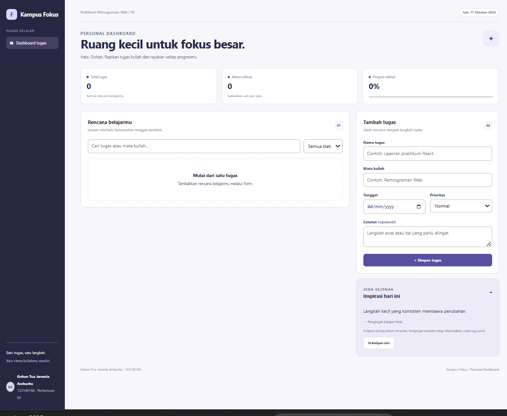
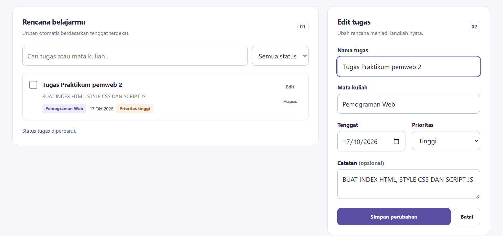
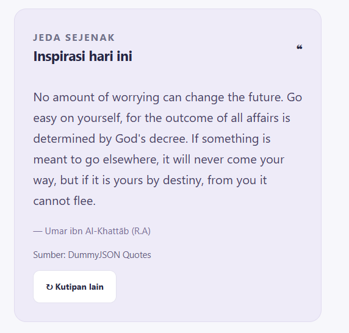

# Kampus Fokus — Personal Dashboard Mahasiswa

Aplikasi tugas Praktikum Pemrograman Web Pertemuan 02: **JavaScript Next Gen (ES6+)**.

## Identitas

| Keterangan | Isi |
| --- | --- |
| Nama lengkap | Gohan Tua Jeremia Ambarita |
| NIM | 123140160 |


## Deskripsi aplikasi

Kampus Fokus adalah personal dashboard untuk membantu mahasiswa mengatur tugas kuliah dalam satu halaman. Pengguna dapat mencatat tugas beserta mata kuliah, tanggal tenggat, prioritas, dan catatan, lalu memantau progres penyelesaiannya.

Aplikasi menyimpan daftar tugas pada browser menggunakan localStorage sehingga data dapat dimuat kembali setelah halaman di-refresh. Dashboard juga menampilkan kutipan dari API publik DummyJSON sebagai pengingat belajar. Aplikasi dibangun menggunakan HTML, CSS, dan JavaScript murni dengan pendekatan object-oriented melalui class `TaskItem` dan `DashboardApp`.

## Fitur aplikasi

- [x] Menambahkan tugas dengan nama, mata kuliah, tenggat, prioritas, dan catatan opsional.
- [x] Mengedit tugas dan membatalkan mode edit.
- [x] Menghapus tugas berdasarkan ID.
- [x] Menandai tugas selesai atau belum selesai.
- [x] Mencari tugas berdasarkan nama tugas atau mata kuliah tanpa membedakan kapitalisasi.
- [x] Memfilter daftar berdasarkan status semua, belum selesai, atau selesai.
- [x] Menggabungkan pencarian dan filter status.
- [x] Mengurutkan tugas belum selesai terlebih dahulu, lalu berdasarkan tenggat terdekat.
- [x] Menampilkan label prioritas dan penanda tugas yang lewat tenggat.
- [x] Menghitung total tugas, jumlah belum selesai, dan persentase progres.
- [x] Menyimpan serta memuat data melalui localStorage menggunakan JSON.
- [x] Mengambil kutipan secara asinkron menggunakan `fetch()` dan `async/await`.
- [x] Menampilkan feedback validasi, kegagalan penyimpanan, dan kegagalan request API.
- [x] Menyediakan tampilan responsif untuk desktop dan perangkat seluler.

## File yang diperlukan

| File / folder | Fungsi |
| --- | --- |
| `index.html` | Struktur dashboard, form tugas, daftar tugas, ringkasan, dan kartu kutipan. |
| `style.css` | Tata letak, warna, komponen, serta aturan tampilan responsif. |
| `script.js` | Model tugas, interaksi, validasi, perhitungan statistik, localStorage, dan API. |
| `README.md` | Dokumentasi aplikasi dan penerapan fitur ES6+. |
| `docs/screenshots/` | Lokasi gambar antarmuka yang dilampirkan dalam dokumentasi. |

Aplikasi utama dapat dijalankan dengan tiga file utama `index.html`, `style.css`, dan `script.js`. Folder `tests/`, `modul/`, dan `tools/` pada paket awal merupakan berkas pendamping; aplikasi utama tidak memuatnya. Penjelasan penggunaannya tersedia pada bagian berkas pendamping di bawah.

## Cara menjalankan

1. Ekstrak proyek dan buka folder `gohantuajeremiaambarita_123140160_pertemuan2` melalui Visual Studio Code.
2. Pasang ekstensi **Live Server**.
3. Klik kanan `index.html`, lalu pilih **Open with Live Server**.
4. Buka alamat lokal yang ditampilkan, misalnya `http://127.0.0.1:5500`.
5. Gunakan koneksi internet untuk mengambil kutipan dari DummyJSON.

Aplikasi utama tidak memerlukan `npm install`, proses build, backend, atau API key. Apabila Python tersedia, alternatif server lokal dari folder proyek adalah:

```bash
python -m http.server 5500
```

Kemudian buka `http://localhost:5500`.

Gunakan browser, profil, dan alamat origin yang sama untuk membaca kembali data tersimpan. Contohnya, `localhost:5500` dan `127.0.0.1:5500` memiliki penyimpanan lokal terpisah.

## Cara menggunakan

1. Isi nama tugas, mata kuliah, tanggal tenggat, dan prioritas. Catatan boleh dikosongkan.
2. Klik **Simpan tugas** untuk menambahkan tugas ke daftar.
3. Gunakan checkbox pada kartu untuk mengubah status penyelesaian.
4. Klik **Edit**, ubah informasi, lalu pilih **Simpan perubahan** atau **Batal**.
5. Klik **Hapus** untuk menghapus tugas yang dipilih.
6. Gunakan pencarian dan filter status untuk menemukan tugas tertentu.
7. Klik **Kutipan lain** untuk meminta kutipan baru.
8. Refresh halaman untuk memeriksa bahwa daftar tugas tetap tersedia.

## Screenshot antarmuka

Siapkan screenshot dari aplikasi yang sudah dijalankan. Simpan gambar dengan nama dan lokasi berikut:

| Screenshot | Nama file | Hal yang ditampilkan |
| --- | --- | --- |
<<<<<<< HEAD
| Dashboard utama |  | Form, beberapa tugas, statistik, dan kartu inspirasi. |
| Mode edit |  | Salah satu tugas sedang diedit pada form. |
| Tampilan seluler |  | Dashboard pada layar sempit untuk menunjukkan responsivitas. |
=======
| Dashboard utama | 
 | Form, beberapa tugas, statistik, dan kartu inspirasi. |
| Mode edit |  | Salah satu tugas sedang diedit pada form. |
| Tampilan seluler |  | Dashboard pada layar sempit untuk menunjukkan responsivitas. |
>>>>>>> 7aedbfa (Commit)


## Daftar fitur ES6+ dan lokasi kode

Nomor baris berikut mengacu pada `script.js` dalam paket pertemuan 2 yang diberikan. Apabila file JavaScript dirapikan atau ditambah, periksa kembali nomor baris melalui editor sebelum dikumpulkan.

| Fitur | Baris awal di `script.js` | Implementasi |
| --- | ---: | --- |
| `const` | 4 | Konstanta key penyimpanan dan referensi yang tidak di-assign ulang. |
| `let` | 152 | Akumulator jumlah tugas selesai yang nilainya berubah saat iterasi. |
| Arrow function: `$` | 5 | Memilih elemen berdasarkan ID. |
| Arrow function: `makeId` | 6 | Membuat ID unik untuk tugas baru. |
| Arrow function: `localDate` | 11 | Menghasilkan tanggal lokal berformat YYYY-MM-DD. |
| Template literals | 141 | Menyisipkan data ke template kartu tugas secara dinamis. |
| Class `TaskItem` | 18 | Memodelkan struktur data setiap tugas. |
| Class `DashboardApp` | 31 | Mengelola state, event, localStorage, dan API. |
| Destructuring parameter | 20 | Mengambil properti objek pada parameter constructor. |
| Spread operator | 101 | Membuat objek/array baru ketika menambah atau memperbarui tugas. |
| Destructuring objek | 74 | Membaca aksi dan ID dari dataset tombol. |
| Async/await | 159 | Menjalankan request kutipan secara asinkron. |
| `await fetch()` | 165 | Mengirim request ke API publik DummyJSON Quotes. |

## Penjelasan teknis dan potongan kode

Potongan berikut diambil dari kode aplikasi. Sebagian merupakan isi method di dalam class, sehingga tidak dimaksudkan untuk dijalankan terpisah sebagai satu berkas baru.

### 1. Deklarasi `const` dan `let`

**File:** `script.js`, baris awal 4.

```javascript
  const STORAGE_KEY = 'gohan:dashboard:v1';
```

`STORAGE_KEY` menggunakan `const` karena referensinya tidak diganti selama aplikasi berjalan. Nilai tersebut menjadi nama key untuk seluruh data tugas milik aplikasi.

**File:** `script.js`, baris awal 152.

```javascript
      let completed = 0;
      this.tasks.forEach(({ done }) => { if (done) completed += 1; });
      const percent = this.tasks.length ? Math.round(completed / this.tasks.length * 100) : 0;
```

Variabel `completed` menggunakan `let` karena nilainya bertambah saat menghitung tugas selesai. Persentase dihitung dari jumlah selesai dibagi total tugas, kemudian dibulatkan. Ketika daftar kosong, progres ditetapkan menjadi 0%.

### 2. Minimal tiga arrow functions

**Arrow function pertama — helper DOM**, `script.js`, baris awal 5.

```javascript
  const $ = (id) => document.getElementById(id);
```

Fungsi `$` mempersingkat pemanggilan `document.getElementById()` agar akses elemen antarmuka lebih mudah dibaca.

**Arrow function kedua — pembuat ID**, `script.js`, baris awal 6.

```javascript
  const makeId = () => globalThis.crypto?.randomUUID?.() ?? `${Date.now()}-${Math.random().toString(36).slice(2)}`;
```

`makeId()` menghasilkan ID unik melalui `crypto.randomUUID()` bila tersedia. Alternatifnya memakai waktu saat ini dan nilai acak. ID digunakan untuk menentukan tugas yang diedit, dihapus, atau diubah statusnya.

**Arrow function ketiga — tanggal lokal**, `script.js`, baris awal 11.

```javascript
  const localDate = () => {
    const now = new Date();
    return `${now.getFullYear()}-${String(now.getMonth() + 1).padStart(2, '0')}-${String(now.getDate()).padStart(2, '0')}`;
  };
```

`localDate()` membentuk string tanggal lokal berformat `YYYY-MM-DD`. Format tersebut dipakai saat menentukan apakah tugas yang belum selesai telah melewati tenggat.

### 3. Classes dan destructuring parameter

**Model tugas `TaskItem`**, `script.js`, baris awal 18.

```javascript
  class TaskItem {
    // Destructuring parameter + default value untuk data baru dan data dari storage.
    constructor({ id = makeId(), title, course, due, priority = 'normal', note = '', done = false }) {
      Object.assign(this, { id, title, course, due, priority, note, done });
    }
    static isValid(item) {
      return item && typeof item.id === 'string' && typeof item.title === 'string'
        && item.title.trim().length >= 3 && item.title.length <= 120
        && typeof item.course === 'string' && item.course.trim().length > 0 && item.course.length <= 80
        && isDate(item.due) && ['normal', 'high', 'low'].includes(item.priority)
        && typeof item.note === 'string' && item.note.length <= 500 && typeof item.done === 'boolean';
    }
  }
```

Class `TaskItem` memodelkan satu tugas. Constructor memakai destructuring untuk mengambil properti objek, serta default parameter untuk ID, prioritas, catatan, dan status awal. Method statis `isValid()` memeriksa data yang dibaca dari localStorage sebelum digunakan.

**Constructor `DashboardApp`**, `script.js`, baris awal 32.

```javascript
    constructor() {
      this.tasks = this.loadTasks();
      this.bindEvents(); this.render();
      $('today').textContent = new Intl.DateTimeFormat('id-ID', { weekday: 'short', day: 'numeric', month: 'long', year: 'numeric' }).format(new Date());
      this.fetchQuote();
    }
```

`DashboardApp` mengatur alur aplikasi: memuat data tersimpan, memasang event listener, merender tampilan, menampilkan tanggal, dan memulai pengambilan kutipan. Method CRUD, penyimpanan, dan API berada dalam class yang sama.

### 4. Template literals untuk rendering dinamis

**File:** `script.js`, baris awal 141. Kutipan berikut merupakan bagian awal template kartu tugas.

```javascript
      $('task-list').innerHTML = visible.length ? visible.map(({ id, title, course, due, priority, note, done }) => `
        <article class="task-card ${done ? 'done' : ''}">
          <input class="task-check" type="checkbox" data-toggle="${escapeHTML(id)}" ${done ? 'checked' : ''} aria-label="Tandai ${escapeHTML(title)} ${done ? 'belum selesai' : 'selesai'}">
          <div class="task-main"><h3>${escapeHTML(title)}</h3>${note ? `<p>${escapeHTML(note)}</p>` : ''}
            <div class="task-meta"><span class="tag">${escapeHTML(course)}</span><time datetime="${due}">${dateLabel(due)}</time>
```

Template literals memakai backtick dan interpolasi `${...}` untuk menyusun kartu berdasarkan data tugas. Misalnya, judul, mata kuliah, tanggal, dan checkbox mengikuti nilai setiap objek. `escapeHTML()` digunakan pada teks pengguna sebelum dimasukkan ke HTML, sehingga teks input tidak diperlakukan sebagai markup.

### 5. Spread operator dan pembaruan state

**File:** `script.js`, baris awal 101.

```javascript
      this.tasks = id ? this.tasks.map((task) => task.id === id ? new TaskItem({ ...task, ...values }) : task)
        : [...this.tasks, new TaskItem(values)];
      this.saveTasks(); this.render(); this.resetForm();
      $('list-status').textContent = id ? 'Perubahan tugas disimpan.' : 'Tugas baru berhasil ditambahkan.';
```

Saat mengedit, `map()` menghasilkan array baru dan spread `{ ...task, ...values }` menggabungkan properti lama dengan perubahan. Saat menambah, `[...this.tasks, new TaskItem(values)]` membuat array baru yang memuat tugas baru. Sesudahnya aplikasi menyimpan data, merender daftar, dan mereset form.

### 6. Destructuring objek pada penanganan aksi

**File:** `script.js`, baris awal 74.

```javascript
        const { action, id } = button.dataset;
        if (action === 'edit') this.editTask(id);
        if (action === 'delete') this.deleteTask(id);
```

Destructuring mengambil `action` dan `id` dari `dataset` tombol. Nilai tersebut menentukan apakah aplikasi menjalankan method edit atau hapus pada tugas yang dipilih.

### 7. Operasi asinkron dengan API riil

API yang digunakan adalah **DummyJSON Quotes**:

```text
https://dummyjson.com/quotes/random
```

**File:** `script.js`, baris awal 159.

```javascript
    async fetchQuote() {
      const button = $('refresh-quote');
      button.disabled = true; $('quote-status').textContent = 'Mengambil kutipan…';
      const controller = new AbortController();
      const timeoutId = setTimeout(() => controller.abort(), 7000);
      try {
        const response = await fetch('https://dummyjson.com/quotes/random', { signal: controller.signal });
        if (!response.ok) throw new Error(`HTTP ${response.status}`);
        const { quote, author } = await response.json();
        if (typeof quote !== 'string' || typeof author !== 'string' || !quote.trim()) throw new Error('Data kutipan tidak valid');
        $('quote-text').textContent = quote; $('quote-author').textContent = `— ${author}`;
        $('quote-status').textContent = 'Sumber: DummyJSON Quotes';
      } catch {
        // CRUD tetap dapat dipakai saat koneksi gagal; tidak ada data tugas yang hilang.
        $('quote-status').textContent = 'Kutipan daring belum tersedia. Pengingat terakhir tetap ditampilkan; coba lagi nanti.';
      } finally {
        clearTimeout(timeoutId); button.disabled = false;
      }
    }
```

Method `fetchQuote()` memakai `async/await` untuk menunggu request HTTP dan membaca respons JSON. Aplikasi memeriksa status HTTP serta properti `quote` dan `author` sebelum memperbarui tampilan.

`AbortController` membatasi waktu tunggu menjadi 7 detik. Tombol kutipan dinonaktifkan selama request berlangsung dan diaktifkan kembali melalui `finally`. Jika request gagal, pesan status memberi informasi kegagalan sementara pengingat lokal atau kutipan sebelumnya tetap ditampilkan. Fitur tugas tetap dapat digunakan ketika layanan kutipan tidak tersedia.

Method ini dipanggil ketika aplikasi dibuka melalui constructor dan ketika tombol **Kutipan lain** ditekan melalui event listener. Teks kutipan mengikuti bahasa sumber API.

### 8. Penyimpanan lokal dan serialisasi JSON

**Pembacaan data**, `script.js`, baris awal 43.

```javascript
        const raw = localStorage.getItem(STORAGE_KEY);
        if (!raw) return [];
        const parsed = JSON.parse(raw);
        if (!Array.isArray(parsed) || !parsed.every(TaskItem.isValid)
          || new Set(parsed.map(({ id }) => id)).size !== parsed.length) throw new Error('Data tidak valid');
        return parsed.map((item) => new TaskItem(item));
```

Data dibaca dari key `gohan:dashboard:v1`, lalu `JSON.parse()` mengubah string JSON menjadi array objek. Struktur array, isi tugas, dan keunikan ID diperiksa sebelum objek dibentuk kembali sebagai instance `TaskItem`.

**Penyimpanan data**, `script.js`, baris awal 54.

```javascript
    saveTasks() {
      try {
        localStorage.setItem(STORAGE_KEY, JSON.stringify(this.tasks));
        $('storage-warning').hidden = true;
      } catch {
        this.showWarning('Penyimpanan browser tidak tersedia. Perubahan hanya tersimpan selama halaman ini terbuka.');
      }
    }
```

`JSON.stringify()` mengubah array tugas menjadi string yang dapat disimpan di localStorage. Penanganan error menampilkan peringatan bila browser menolak penyimpanan; data dalam memori tetap dapat dipakai selama halaman terbuka.

### 9. Validasi input

**File:** `script.js`, baris awal 88.

```javascript
      const errors = {
        title: values.title.length < 3 ? 'Nama tugas minimal 3 karakter.' : values.title.length > 120 ? 'Nama tugas maksimal 120 karakter.' : '',
        course: !values.course ? 'Mata kuliah wajib diisi.' : values.course.length > 80 ? 'Mata kuliah maksimal 80 karakter.' : '',
        due: !isDate(values.due) ? 'Pilih tanggal tenggat yang valid.' : '',
      };
      Object.entries(errors).forEach(([key, message]) => {
        $(`${key}-error`).textContent = message;
        $(`task-${key}`).setAttribute('aria-invalid', String(Boolean(message)));
      });
      const first = Object.keys(errors).find((key) => errors[key]);
      if (first) { $(`task-${first}`).focus(); return; }
```

Judul tugas wajib minimal 3 karakter dan maksimal 120 karakter. Mata kuliah wajib diisi dan maksimal 80 karakter. Tanggal tenggat harus valid. Jika ada kesalahan, pesan ditampilkan pada field terkait dan fokus diarahkan ke input pertama yang salah. Data yang tidak valid tidak dimasukkan ke daftar.

## Alur kerja aplikasi

1. Aplikasi memuat dan memvalidasi data dari localStorage.
2. Event listener dihubungkan dengan form, tombol, checkbox, pencarian, dan filter.
3. Pengguna menambah atau mengubah data melalui form yang divalidasi.
4. Operasi CRUD memperbarui array `this.tasks`.
5. Data disimpan sebagai JSON dan tampilan beserta statistik diperbarui.
6. Request kutipan berjalan secara asinkron dan memperbarui kartu inspirasi ketika berhasil.

